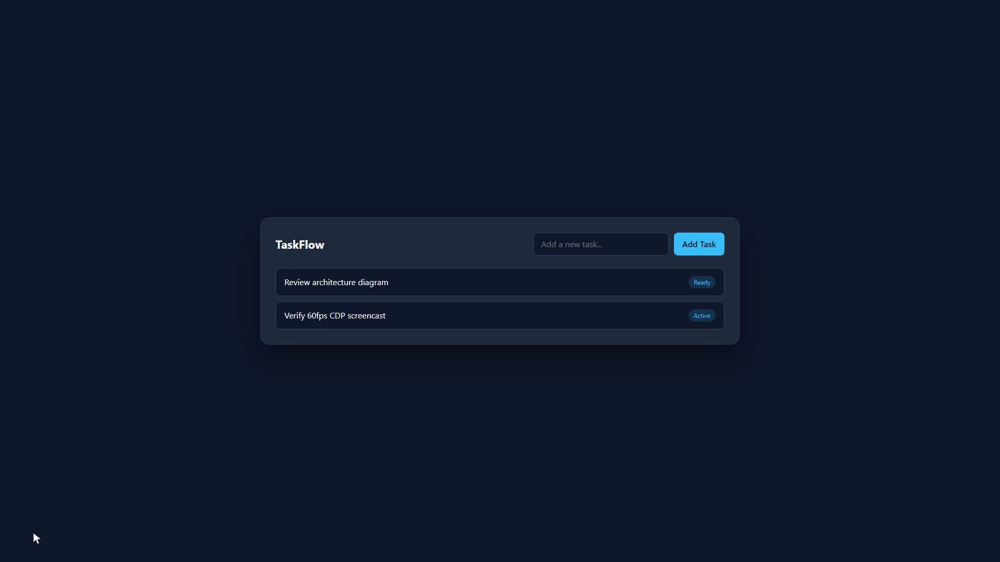

# DEWI — Demo Engine for Web Interaction

A Windows-native, zero-watermark Playwright + CDP screencast engine for recording narrated web app walkthroughs with smooth cursor motion, dynamic CSS zoom-ins, keyboard shortcut hints, 2x retina screenshots, and local offline voice-over.

## Sample Recording

Recorded from [`examples/sample-app`](examples/sample-app) (`1920x1080`, `60fps` H.264 + offline Windows SAPI voice-over):

https://github.com/user-attachments/assets/522a147c-a218-4824-8025-ded366d23e78

[](examples/sample-app/demo-out/dark/overview.mp4)

- Video: [examples/sample-app/demo-out/dark/overview.mp4](examples/sample-app/demo-out/dark/overview.mp4)
- 2x Retina Still: [examples/sample-app/demo-out/dark/overview-added.png](examples/sample-app/demo-out/dark/overview-added.png)

## Prerequisites

- **Node.js** `>= 22.18` (uses native TypeScript type-stripping)
- **ffmpeg** on `PATH` (with `libx264` or `h264_videotoolbox`)
- **Playwright Chromium** (`npx playwright install chromium`)

## Quick Start

```powershell
npm install
npm run doctor
```

### Scaffold a workspace for your app or URL

```powershell
# Local web app (build + in-process mocks + pinned clock)
node bin/cli.mjs init C:\path\to\your-app

# Live public URL
node bin/cli.mjs init --site https://example.com --project .\my-demo
```

### Record scenes

```powershell
# Run the included sample demo (Windows offline SAPI voice-over)
node bin/cli.mjs run --project .\examples\sample-app

# Run silent (no voice-over)
$env:DEMO_VOICE = "0"
node bin/cli.mjs run --project .\examples\sample-app

# Check frame pacing histograms
node bin/cli.mjs gaps .\examples\sample-app\demo-out
```

## Outputs

Generated inside `<project>/demo-out/`:
- `<theme>/<scene>.mp4` — Constant-FPS H.264 video (1080p60 by default)
- `<theme>/<scene>*.png` — 2x retina screenshots (cursor & key hints hidden)
- `<theme>/<scene>.poster.jpg` — First-frame poster image
- `<theme>/full-tour.mp4` — Stream-copied tour combining all scenes (when 2+ scenes exist)
- `manifest.json` & `index.html` — Corpus metadata and interactive gallery viewer

## Voice Backends

Set `DEMO_VOICE`:
- `auto` (default) — Uses Kokoro ONNX in `~/.cache/demo-voice` if installed, otherwise uses Windows built-in offline `System.Speech` SAPI.
- `kokoro` — Requires Kokoro ONNX Python venv (`~/.cache/demo-voice`).
- `sapi` — Forces Windows offline `System.Speech` synthesis.
- `0` / `off` — Silent recording.

## License

MIT © `fathirramadhan-web` — see [LICENSE](LICENSE).
